<p align="center">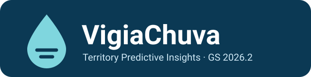</p>

# VigiaChuva: painel de inteligência territorial

**Antecipa o risco de chuva forte e alagamento no território e explica cada alerta (evidências, confiança e limitações), para que gestores públicos e moradores decidam a tempo.**

Global Solution 2026.2, FIAP, Cross-Platform Application Development. Desafio CitizenTech: *Territory Predictive Insights*.

---

## 2. Problema e público

**Problema que o app antecipa:** em chuvas intensas, ruas alagam, córregos transbordam e encostas encharcadas podem deslizar. Os sinais aparecem horas antes (previsão de chuva forte, córrego subindo, relatos de bueiros entupidos), mas ficam espalhados e chegam tarde a quem pode agir.

**Para quem:**
- **Gestores públicos** (Defesa Civil, subprefeitura, zeladoria): veem num só painel a chuva prevista, a drenagem e os relatos, e recebem alertas justificados para priorizar equipes.
- **Moradores e lideranças comunitárias:** acompanham o risco do bairro e registram ocorrências de forma anônima.

**Impacto social esperado:** ganhar tempo de reação (limpar bocas de lobo, avisar moradores, avaliar retirada preventiva) e reduzir pessoas afetadas por desastres ligados à água, em linha com os ODS 11 (meta 11.5) e 13 (meta 13.1). O app exibe um **indicador de benefício social**: quantos moradores vivem em regiões com alerta ativo, com quantas horas de antecedência a chuva forte foi avisada e quantos relatos a comunidade fez.

## 3. Integrantes

| Nome completo | RM |
|---|---|
| Rafael do Nascimento Silva | 566263 |
| Guilherme Morais de Assis | 564198 |

## 4. Demonstração visual

Capturas do app em largura de celular (412 px), além de alto contraste e tablet. Arquivos em `assets/screenshots/`.

| | | |
|:---:|:---:|:---:|
| 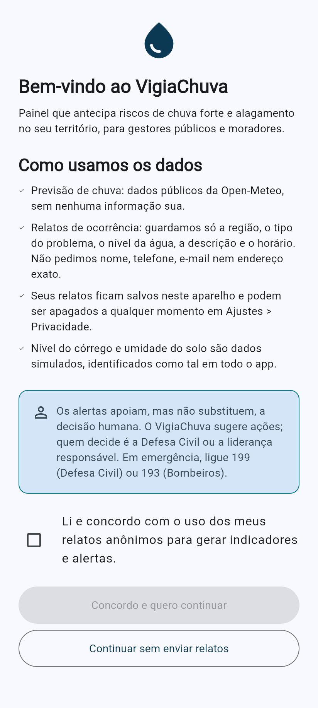<br>**Consentimento** (1ª abertura, LGPD) | 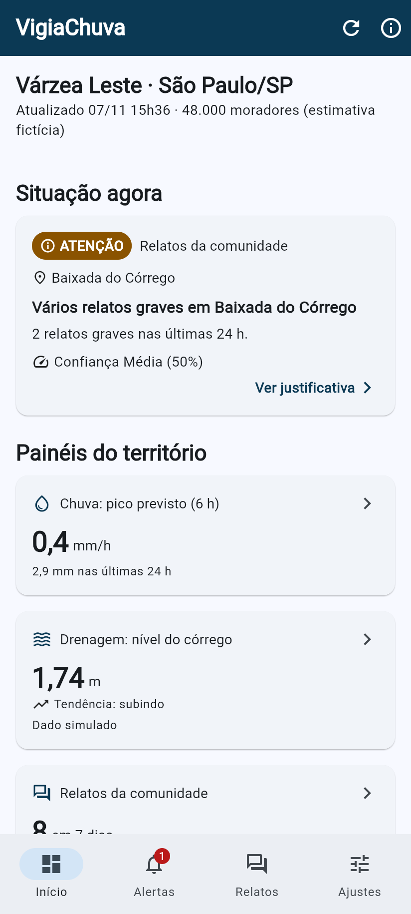<br>**Início**: situação, painéis e benefício social | 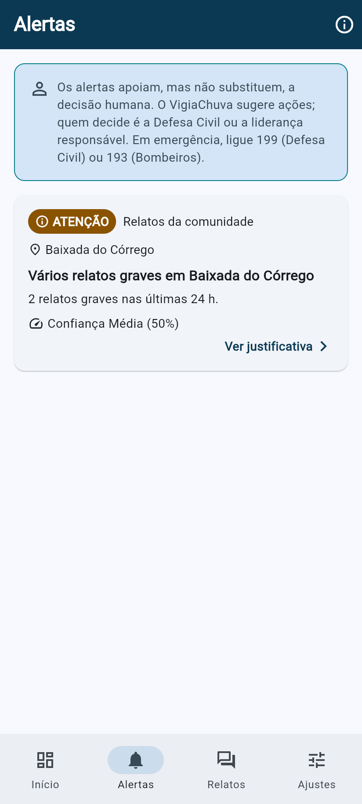<br>**Alertas** ativos, do mais grave ao menos grave |
| 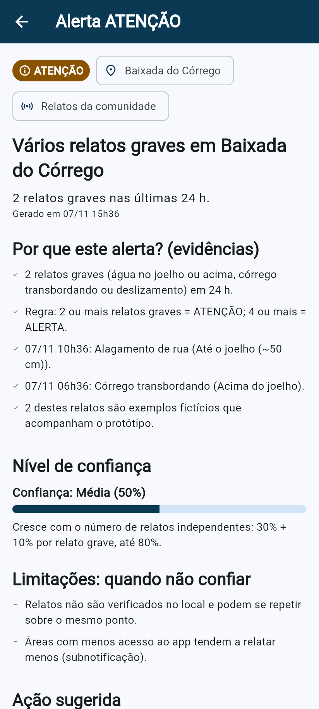<br>**Detalhe do alerta**: evidências, confiança, limitações | 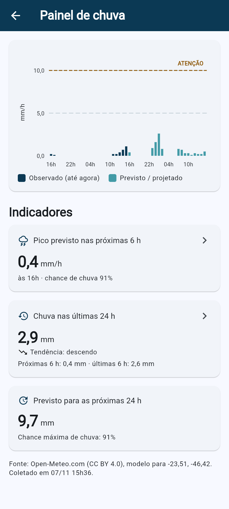<br>**Painel de chuva** (dados reais Open-Meteo) | 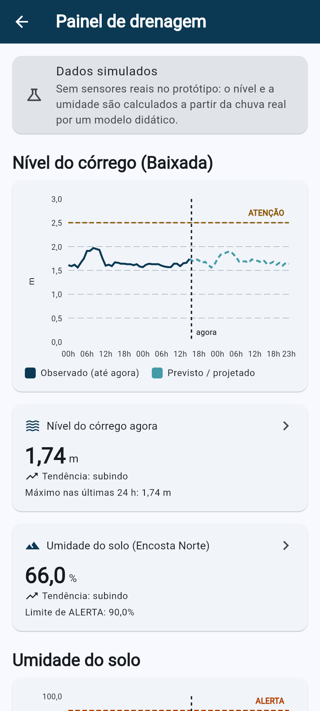<br>**Painel de drenagem**: córrego e solo (simulados) |
| 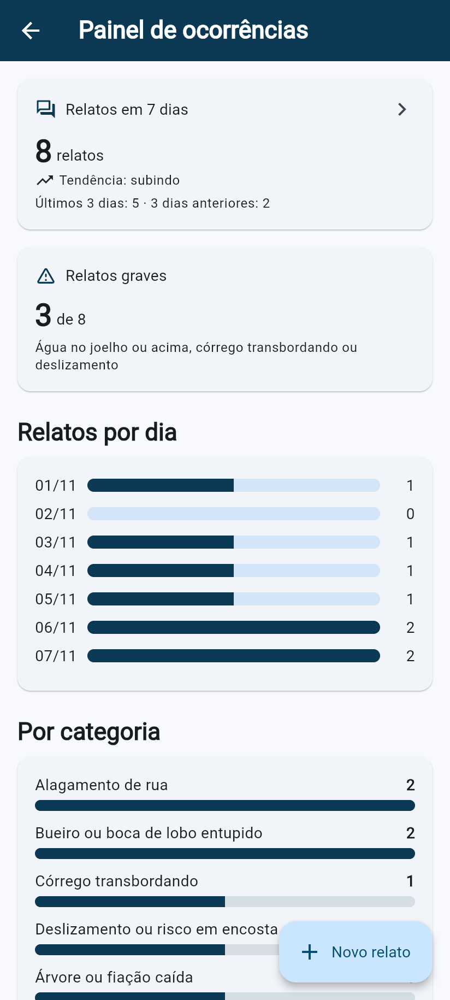<br>**Painel de ocorrências** por dia, categoria e região | 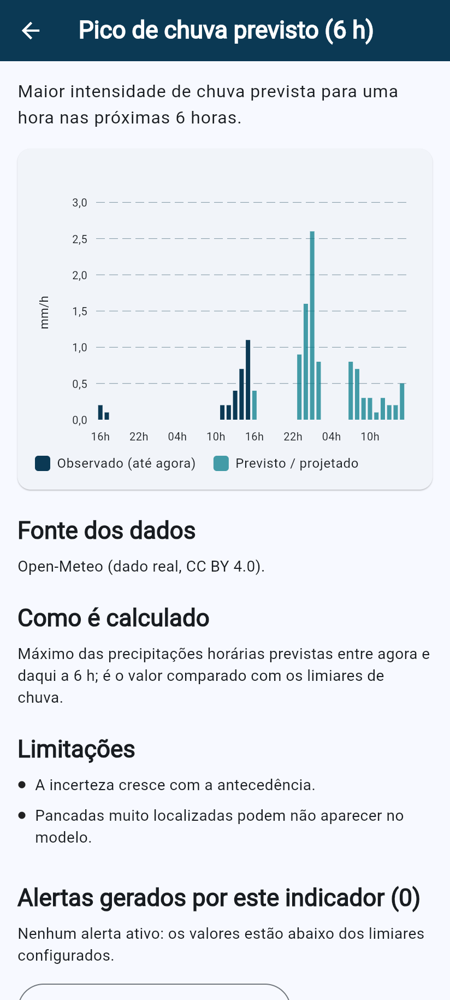<br>**Detalhe do indicador**: fonte, cálculo, limitações | 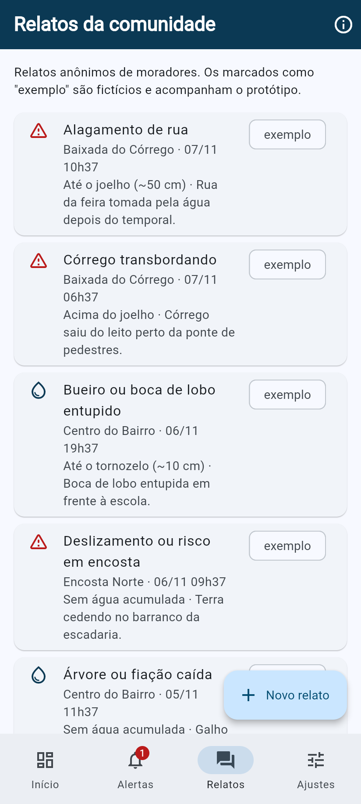<br>**Relatos** da comunidade |
| 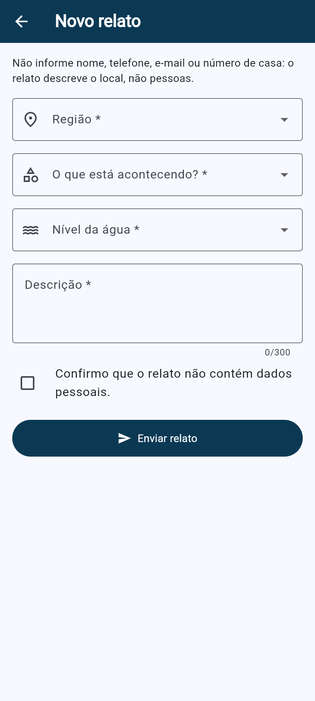<br>**Novo relato** (formulário com validação) | 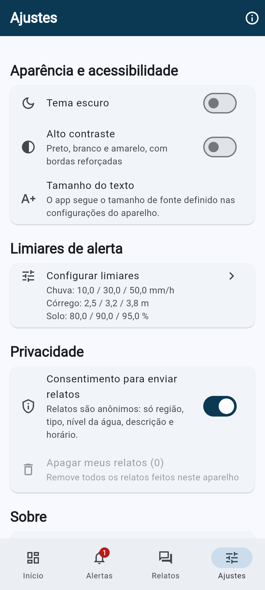<br>**Ajustes**: tema, contraste, privacidade | 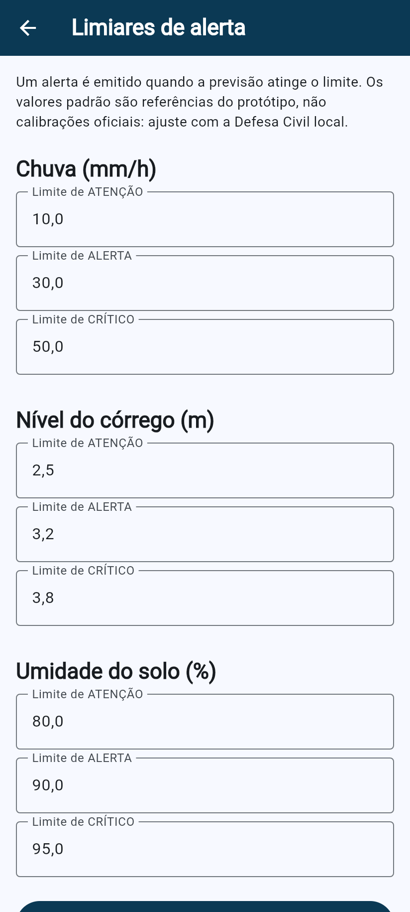<br>**Limiares** de alerta (formulário) |
| 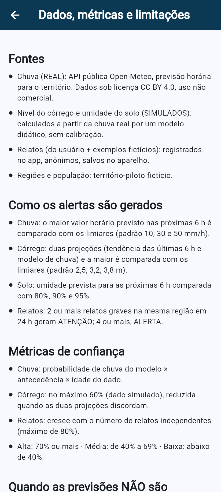<br>**Dados, métricas e limitações** | 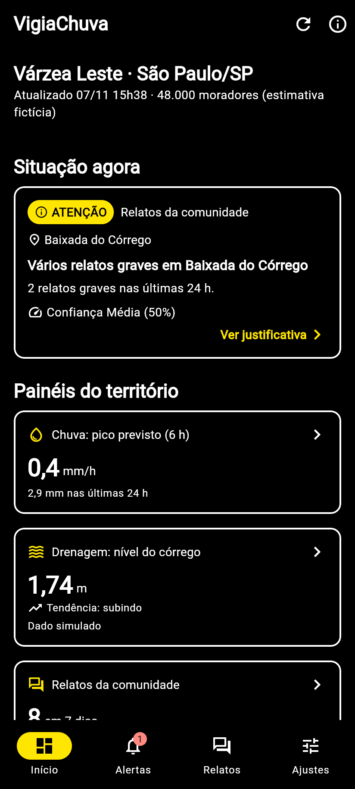<br>**Alto contraste** (tema escuro) | 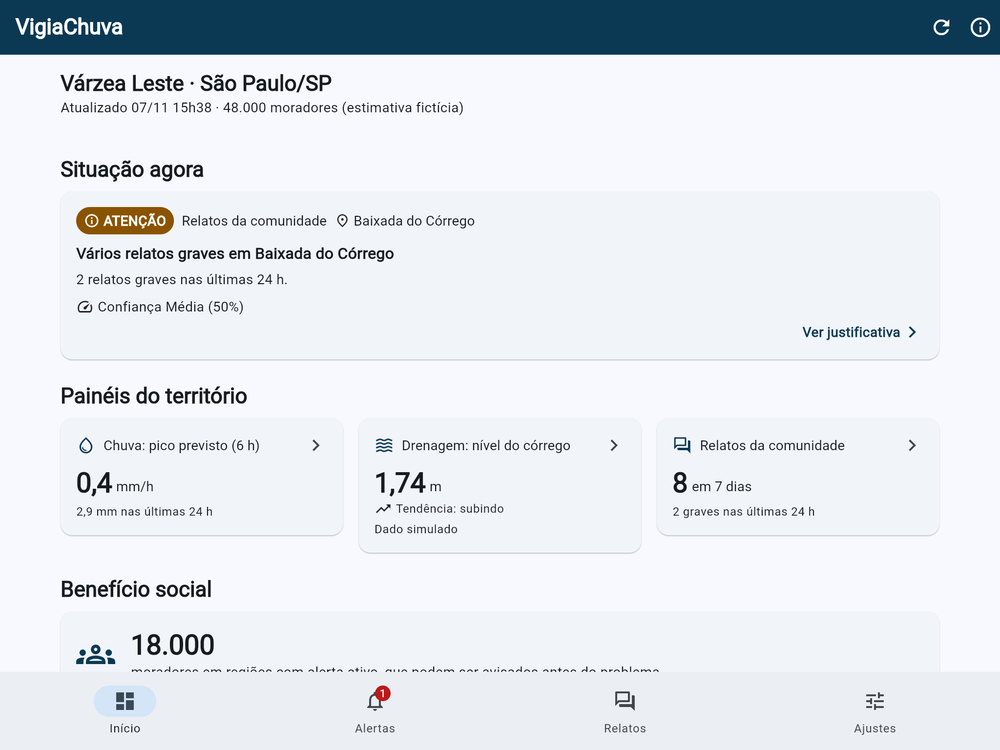<br>**Tablet** (1024 px): grade de 3 colunas |

## 5. Funcionalidades

- [x] 13 telas: **10 rotas nomeadas** (incluindo a tela principal, que abriga 4 abas), com passagem de parâmetros (`/indicador` e `/alerta` recebem o id). Fluxo: visão geral → painel → detalhe do indicador → detalhe do alerta (e de volta ao painel).
- [x] **3 dashboards territoriais** (chuva, drenagem e ocorrências) com gráficos, cartões, histórico e tendência.
- [x] **Alertas preditivos** a partir de regras e previsões, cada um com evidências, nível de confiança calculado, limitações e ação sugerida.
- [x] **Aviso visível** de que os alertas apoiam, mas não substituem, a decisão humana (Início, Alertas, detalhe e consentimento).
- [x] **Estado global** (Provider) compartilhado entre Início, painéis, Alertas e detalhes; **estado local** em formulários e navegação.
- [x] Estados de **carregamento**, **erro** (com "Tentar de novo") e **lista vazia** tratados.
- [x] **API real**: previsão horária de chuva da Open-Meteo.
- [x] **Persistência local** (shared_preferences): cache da previsão, relatos, limiares, tema, contraste e consentimento.
- [x] **Funciona sem conexão**: usa a última previsão salva, com faixa "Sem conexão" e data; drenagem e relatos são locais.
- [x] **Formulários com validação**: novo relato (bloqueia telefone e e-mail na descrição) e limiares (faixa e ordem ATENÇÃO < ALERTA < CRÍTICO).
- [x] **Indicador de benefício social** no Início.
- [x] **Identidade visual** própria com tema e componentes reutilizáveis; layout responsivo (1, 2 ou 3 colunas).
- [x] **Acessibilidade**: alto contraste, tema escuro, fonte ampliada sem quebra (testado a 200%), descrições para leitores de tela e alvos de toque de 48 px.
- [x] **Privacidade**: relatos anônimos, consentimento explícito e revogável, botão para apagar os próprios relatos.
- [x] **Diferenciais**: dados reais (Open-Meteo), modo escuro e alto contraste, **23 testes automatizados** (unidade e widget).

## 6. Dados e alertas

### Fontes
| Dado | Tipo | Origem |
|---|---|---|
| Chuva horária (24 h passadas + 24 h previstas) e probabilidade | **Público, real** | API [Open-Meteo](https://open-meteo.com/en/docs) (`precipitation`, `precipitation_probability`), sem chave, uso não comercial, licença CC BY 4.0 |
| Nível do córrego e umidade do solo | **Sintético** | Calculados a partir da chuva real por um modelo didático (nível-base 1,6 m + 4,5 cm por mm de chuva nas últimas 6 h; o solo encharca 0,6 ponto percentual por mm e seca 4% da diferença por hora) |
| Relatos | **Do usuário + exemplos fictícios** | Registrados no app (anônimos); 8 relatos de exemplo marcados como "exemplo" |
| Regiões e população | **Fictício** | Território-piloto "Várzea Leste" (3 regiões, 48 mil moradores estimados) com coordenadas reais da Zona Leste de São Paulo (-23,50; -46,40) |

### Como os alertas são gerados (`lib/dominio/motor_alertas.dart`)
| Fonte | Regra | Limiares padrão (editáveis) |
|---|---|---|
| Chuva | Maior chuva horária prevista nas próximas 6 h | 10 / 30 / 50 mm/h |
| Córrego | Maior entre a projeção pela tendência (média das últimas 3 h + variação em relação às 3 h anteriores) e a projeção do modelo para as próximas 6 h | 2,5 / 3,2 / 3,8 m |
| Solo | Umidade máxima prevista para as próximas 6 h na encosta | 80 / 90 / 95 % |
| Relatos | Relatos graves (água no joelho ou acima, córrego transbordando, deslizamento) na mesma região em 24 h | 2 = ATENÇÃO; 4 = ALERTA |

### Métricas de confiança
- **Chuva:** probabilidade de chuva do modelo no horário do pico × fator de antecedência (1,0 até 3 h; 0,85 depois) × fator de atualização (0,7 se o dado está em cache há 3 h ou mais).
- **Córrego:** começa em 60% (dado simulado, um ponto) e cai quando as duas projeções divergem (−0,4 por metro de diferença) ou sem chuva real.
- **Solo:** fixa em 45% (30% sem chuva real).
- **Relatos:** 30% + 10% por relato grave, até 80%.
- Rótulo: **Alta** ≥ 70%, **Média** de 40% a 69%, **Baixa** < 40%.

### Limitações, vieses e quando NÃO confiar
- O modelo meteorológico tem resolução de quilômetros: pancadas de verão muito localizadas podem não aparecer.
- Previsões de chuva intensa e com mais de 3 h de antecedência acertam menos.
- **Córrego e solo são simulados**: servem para demonstrar o fluxo, não para decisões reais.
- Com menos de 6 h de histórico o app **não** projeta o córrego (o sistema se cala).
- Os limiares padrão são referências do protótipo, **não calibradas** com o histórico de alagamentos do território.
- **Subnotificação:** regiões com menos acesso ao app relatam menos e parecem mais seguras; relatos não são verificados e podem se repetir.
- O horário segue o fuso de São Paulo; em aparelhos com outro fuso as horas podem ficar deslocadas.
- O app **nunca toma decisão automática**: só sugere ações e lembra que quem decide é a Defesa Civil ou a liderança responsável.

## 7. Privacidade e inclusão

**Privacidade (LGPD):**
- O relato guarda só região, tipo, nível da água, descrição e horário. **Não** há nome, telefone, e-mail nem endereço exato. A descrição é validada para recusar telefone e e-mail.
- **Consentimento explícito** na primeira abertura; pode ser revogado em Ajustes > Privacidade. Sem consentimento, o app funciona, mas não envia relatos.
- Os relatos ficam **apenas no aparelho** e podem ser apagados (Ajustes > "Apagar meus relatos").
- Não há chaves de API: a Open-Meteo dispensa autenticação.

**Acessibilidade e inclusão:**
- Tema de **alto contraste** (preto, branco e amarelo) e **tema escuro**; as cores de alerta têm contraste ≥ 4,5:1 com o texto branco.
- O nível do alerta nunca depende só da cor: há sempre ícone e texto (ATENÇÃO, ALERTA, CRÍTICO).
- **Fonte ampliada**: o app respeita o tamanho de fonte do aparelho; há teste automatizado a 200% sem estouro de layout.
- **Leitores de tela** (TalkBack/VoiceOver): `Semantics` com descrições nos cartões, gráficos (resumo em texto), selos e botões; títulos marcados como cabeçalho; tooltips nos ícones.
- Alvos de toque de no mínimo 48 px e layout responsivo (celular e tablet).

## 8. Tecnologias e decisões técnicas

| Escolha | Por quê |
|---|---|
| **Flutter 3.47 / Dart 3.9+** | Um código para Android, iOS e web |
| **provider** (ChangeNotifier) | Estado global simples e testável, como visto no semestre; três controllers com responsabilidades separadas (`PreferenciasController`, `OcorrenciasController`, `TerritorioController`) |
| **http** | Cliente leve; permite `MockClient` nos testes, sem rede |
| **shared_preferences** | Persistência local suficiente para cache, relatos, limiares e preferências, inclusive na web |
| **fl_chart** | Gráficos de barra e linha com linhas de limiar e marcação de "agora" |
| **Open-Meteo** | Previsão real, gratuita, sem chave e com CORS liberado (funciona também na web) |
| **Rotas nomeadas + `onGenerateRoute`** | Uma tabela central de rotas com passagem de parâmetro; na web aceita deep link (`#/alerta?id=...`) |
| **Repositório com fallback** | `RepositorioTerritorio` tenta a API e, se falhar, usa o cache: é isso que mantém o app útil offline |
| **Motor de alertas puro** | `MotorAlertas` não depende de Flutter: as regras são testadas por testes de unidade |

**Arquitetura (pastas):**
```
lib/
├── app/          rotas nomeadas e tema (identidade visual, espaçamentos)
├── core/         território-piloto e formatação pt-BR
├── data/         modelos, serviços (Open-Meteo, dados sintéticos, armazenamento local) e repositório
├── dominio/      motor de alertas, indicadores (benefício social) e validadores
├── estado/       controllers globais (ChangeNotifier)
└── ui/
    ├── componentes/  cartões, selos, estados (carregando/erro/vazio), gráficos reutilizáveis
    └── telas/        13 telas (10 rotas nomeadas + 4 abas na tela principal)
test/             23 testes: regras de alerta, dados/offline, validadores e widgets
```

## 9. Como executar

Pré-requisitos: **Flutter 3.35 ou superior** (testado no 3.47.9 stable) e um emulador Android, um dispositivo físico ou o Chrome.

```bash
git clone https://github.com/rafadonas/vigiachuva_app.git
cd vigiachuva_app
flutter pub get
flutter run                 # escolha o emulador/dispositivo
# ou: flutter run -d chrome
```

- **Variáveis de ambiente:** nenhuma. A Open-Meteo não exige chave.
- **Testes:** `flutter test` (23 testes; não acessam a internet).
- **Testar o modo offline:** abra o app com internet uma vez (a previsão fica salva), ative o modo avião e puxe para atualizar: aparece a faixa "Sem conexão" com a data dos dados.
- **Gerar APK:** `flutter build apk --release` (requer Android SDK).
- **APK pronto (bônus):** `VigiaChuva-release.apk` acompanha a entrega. É um build de release testado em emulador Android 16 (Pixel, API 36): o app abre, busca a previsão real, gera alertas e funciona em modo avião, sem erros no logcat. Para instalar: `adb install VigiaChuva-release.apk`.

## 10. Vídeo

▶️ **[link do vídeo de demonstração]** (2 min 58 s, legendado em português)

O vídeo foi gravado no emulador Android com o APK de release e mostra todas as telas: consentimento, início com benefício social, os três painéis, detalhe de indicador, alertas com justificativa, a geração de um alerta de chuva ao baixar o limiar de ATENÇÃO para 0,1 mm/h, o relato bloqueado por conter telefone, tema escuro, alto contraste, fonte a 200% e modo offline. O arquivo local é `VigiaChuva_demo_CPAD.mp4`, com legendas também em `.srt`.

## 11. Licença

Projeto acadêmico, FIAP, Global Solution 2026.2. Dados meteorológicos: Open-Meteo.com, sob licença [CC BY 4.0](https://creativecommons.org/licenses/by/4.0/).
